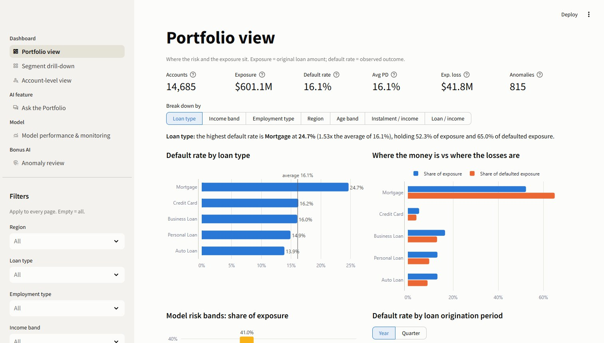

# Credit Risk Portfolio Analytics: Assignment Deliverables

**Data:** the 5 provided tables (customers, loan_accounts, bureau_credit, repayment_history, collections_events),
10,000 customers and 14,685 loan accounts. **Format:** code repo and notebooks + Streamlit dashboard + short deck.

This README follows the assignment brief section by section. Each requirement is quoted, followed by what was built
and where it lives.



## 1. Data Ingestion

| Brief | What was built | Where |
|---|---|---|
| Load and join all 5 tables (document your join logic / keys used) | `loan_accounts` is the spine (1 row per loan); bureau and repayment are aggregated to 1 row per customer / account first, then joined on `customer_id` / `account_id`; every join validated, row count asserted | [`notebooks/01_data_ingestion.ipynb`](notebooks/01_data_ingestion.ipynb) §1.1, `src/ingest.py` |
| Handle missing values, inconsistent labels, and other data quality issues: state how, not just "dropped nulls" | 45 automated checks; 30 issues fixed or flagged, each with rows affected and the action taken (e.g. 294 missing interest rates recovered exactly from the loan payment formula); no rows dropped | §1.2, `data/processed/dq_log.csv` |
| Output: one clean, analysis-ready dataset (+ a short data quality notes section) | `accounts_clean.csv`: 14,685 rows x 85 columns, plus short data quality notes | `data/processed/accounts_clean.csv`, [`docs/data_quality_notes.md`](docs/data_quality_notes.md) (short notes at the top) |

## 2. Data Analytics

| Brief | What was built | Where |
|---|---|---|
| Portfolio profiling across key dimensions: income, employment type, region, age, loan type | Default rate, exposure share and defaulted-exposure share for every segment of all five dimensions, plus affordability | [`notebooks/02_data_analytics.ipynb`](notebooks/02_data_analytics.ipynb) §2.2–2.3 |
| 4-5 concrete insights with a "so what" (e.g. segment X = Y% of exposure, Z% higher default rate) | 5 insights in exactly that pattern, each with a policy "so what" | §2.6, [`docs/insights.md`](docs/insights.md) |
| At least one cross-dimensional cut (e.g. income x employment, or region x loan type) | Both of the brief's examples, plus loan-to-income x loan type and instalment-to-income x loan type | §2.4 |

**The 5 insights** (portfolio average default rate 16.1%):
1. **Mortgages = 52.3% of exposure, 53% higher default rate.** So what: review mortgage underwriting; get collateral data.
2. **Instalment at 30%+ of income = 32.6% of exposure, 59% higher default rate.** So what: a hard affordability cap.
3. **Income under $50k = 12.7% of exposure, 74% higher default rate.** So what: income-tiered limits, verified income.
4. **Unemployed and under $30k = 1.6% of exposure, 175% higher default rate** (income x employment). So what: manual
   underwriting with verified alternative income.
5. **South-region mortgages = 14.0% of exposure, 70% higher default rate** (region x loan type). So what: review that
   book; no region-level policy.

## 3. Model Building

| Brief | What was built | Where |
|---|---|---|
| Predict `target_default` using engineered features (aggregate bureau + repayment history, not just raw application fields) | Bureau aggregated per customer (active lines, write-offs, days past due, debt-to-income, lender mix); repayment aggregated per account (late / missed counts, worst days past due, recent misses) | [`notebooks/03_model_building.ipynb`](notebooks/03_model_building.ipynb) §3.0, `src/features.py` |
| Baseline (logistic regression) + one ML model (XGBoost / LightGBM) | Logistic regression and LightGBM, tuned with the same customer-grouped cross-validation, tested on unseen customers and out of time | §3.1, `src/train_model.py` |
| Report AUC, KS, Gini + feature importance / SHAP | Logistic regression: **AUC 0.687, Gini 0.375, KS 0.288** (out-of-time AUC 0.700). LightGBM: AUC 0.678, Gini 0.356, KS 0.277. SHAP for both | §3.1–3.2, [`docs/model_report.md`](docs/model_report.md) |
| One paragraph: how you'd monitor this model post-deployment (PSI/CSI, retraining cadence) | Monthly PSI / CSI with thresholds, quarterly performance and fairness, annual retraining | §3.4, model report |

## 4. Dashboard

| Brief | What was built | Where |
|---|---|---|
| Interactive (Streamlit / JSX / HTML, your choice) | Streamlit + Plotly | `app/app.py` |
| Portfolio view: risk segments, exposure, trends across dimensions | **Dashboard → Portfolio view**: KPIs, default rate and exposure by any dimension, risk bands, trends by origination year / quarter | page "Portfolio view" |
| Account-level view: individual risk score + key drivers | **Dashboard → Account-level view**: predicted PD, risk band, exact drivers, repayment history, bureau lines | page "Account-level view" |
| Minimum one working filter / drill-down | Seven sidebar filters shared by every page, plus **Segment drill-down**: cross two dimensions, open any cell (it starts on the riskiest one with enough accounts), then click into an account | sidebar, page "Segment drill-down" |

## 5. AI Feature

| Brief | What was built | Where |
|---|---|---|
| Pick one, embedded in the dashboard | **"Ask the Portfolio" chat**: natural-language Q&A over the dashboard data using an LLM (NVIDIA Nemotron), grounded in the actual data. The brief's own example, *"which segment has the highest default rate this quarter?"*, is the first suggested question | **AI feature → Ask the Portfolio**, `src/chat.py` |
| Grounded in the actual underlying data (no hallucinated numbers) | The LLM can only call 8 query tools that compute numbers from the data; every number in an answer is checked against the tool results and against the segment it is placed next to, and anything that fails is flagged with its source shown. Without an API key, a rule-based mode answers the common questions through the same tools and check | [`docs/ai_features.md`](docs/ai_features.md) |
| State clearly: what triggers the AI feature, what a false positive / negative looks like, and the human-in-the-loop step | Stated on the dashboard page itself, in the AI feature document, and in the notebook | page boxes, docs, [`notebooks/04_ai_feature.ipynb`](notebooks/04_ai_feature.ipynb) |

**Bonus AI (beyond the brief):** anomaly detection, flagging accounts unusual for their peer group or their own
history, with an analyst confirm / dismiss queue (**Bonus AI → Anomaly review**). 815 flagged accounts default at
32.4%, twice the portfolio rate. Details at the end of `docs/ai_features.md` and notebook 04.

## Also Required

| Brief | Where |
|---|---|
| 1-page product brief: problem, target user, scope (in / out) | [`docs/product_brief.pdf`](docs/product_brief.pdf) (1 page), [`docs/product_brief.md`](docs/product_brief.md) |
| Architecture diagram: ingestion → analytics → model → dashboard (+ AI feature), tools at each stage | [`docs/architecture.png`](docs/architecture.png), [`docs/architecture.md`](docs/architecture.md) |
| 10-min pitch deck: presented as if to a bank's Chief Risk Officer; must include risk / compliance angle | [`deck/credit_risk_pitch_deck.pdf`](deck/credit_risk_pitch_deck.pdf) and [`.pptx`](deck/credit_risk_pitch_deck.pptx) with speaker notes: 10 main slides (risk and compliance on slide 9), then the bonus and the appendix |
| Assumptions log: anything invented or approximated, and what a real bank's IT / data team would need to ship this | [`docs/assumptions_log.md`](docs/assumptions_log.md) (Part A and Part B) |

## Run it

Python 3.11+ (built on 3.13).

```bash
git clone https://github.com/gitnitishmalik/CRP.git
cd CRP
pip install -r requirements.txt
python run_pipeline.py          # clean -> train -> score -> anomalies (under 2 minutes)
streamlit run app/app.py        # dashboard at http://localhost:8501
pytest                          # optional: 61 automated checks of the data, model, chat and every page
```

For the LLM chat, add a free NVIDIA API key (https://build.nvidia.com):

```bash
cp .streamlit/secrets.toml.example .streamlit/secrets.toml   # then paste your key
```

Without a key the chat runs in an offline rule-based mode that answers the suggested and similar questions with the
same tools and number check; everything else works unchanged. The key file is git-ignored.

## Project layout

```
data/raw/            the 5 provided CSV tables and their data dictionary
data/processed/      generated by run_pipeline.py (clean dataset, scores, anomalies, DQ log)
data/review/         chat ratings and anomaly decisions logged by the dashboard
src/                 config, ingest, portfolio (shared analytics), features, train_model, evaluation, chat, anomaly
app/                 Streamlit dashboard (app.py) and chart builders (charts.py)
notebooks/           01 data ingestion, 02 data analytics, 03 model building, 04 AI feature (executed, with outputs)
models/, reports/    trained models, metrics, deciles, fairness and monitoring baselines
docs/                data quality notes, insights, model report, AI feature, product brief, architecture, assumptions
deck/                pitch deck (PDF, and PPTX with speaker notes)
tests/               automated checks (pytest)
```

The data is synthetic, provided with the assignment.
