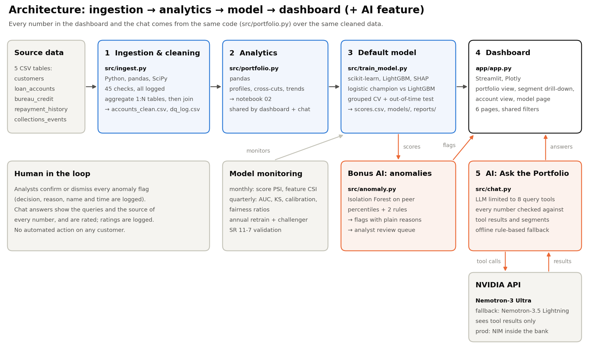
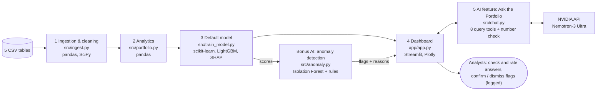

# Architecture diagram

Ingestion → analytics → model → dashboard (+ AI feature), with the tools at each stage.

The image is drawn by `docs/make_architecture.py`; the Mermaid version below renders on GitHub.

| Stage | Code | Tools | Output |
|---|---|---|---|
| 1. Ingestion | `src/ingest.py`, `notebooks/01_data_ingestion.ipynb` | Python 3.13, pandas, SciPy | `accounts_clean.csv` (14,685 x 85), cleaned detail tables, `dq_log.csv` (45 checks) |
| 2. Analytics | `src/portfolio.py`, `notebooks/02_data_analytics.ipynb` | pandas, matplotlib | segment profiles, cross-cuts, trends; the same functions feed the dashboard and the chat |
| 3. Model | `src/features.py`, `src/train_model.py`, `notebooks/03_model_building.ipynb` | scikit-learn (logistic regression), LightGBM, SHAP | `scores.csv` (PD, band, drivers for every account), `models/*.joblib`, `reports/` |
| 4. Dashboard | `app/app.py`, `app/charts.py` | Streamlit, Plotly | portfolio view, segment drill-down, account-level view, model page; shared filters |
| 5. AI feature | `src/chat.py`, `notebooks/04_ai_feature.ipynb` | NVIDIA API (Nemotron, OpenAI-compatible), requests | grounded answers with number check, `data/review/chat_feedback.csv` |
| Bonus AI | `src/anomaly.py`, `notebooks/04_ai_feature.ipynb` | scikit-learn Isolation Forest | `anomalies.csv`, review queue, `data/review/anomaly_reviews.csv` |
| Orchestration | `run_pipeline.py` | Python | rebuilds stages 1, 3 and the bonus AI in order |

**Design principle:** one source of numbers. The notebooks, the dashboard and the chat tools all call the same
functions in `src/portfolio.py` on the same cleaned data, so a figure can't differ between them. The LLM never
computes anything itself.

**Production path** (see the assumptions log): monthly scheduled runs (Airflow), the bank's data warehouse in place of
CSVs, a model registry, the dashboard behind single sign-on, and Nemotron served as an NVIDIA NIM inside the bank's
network.
